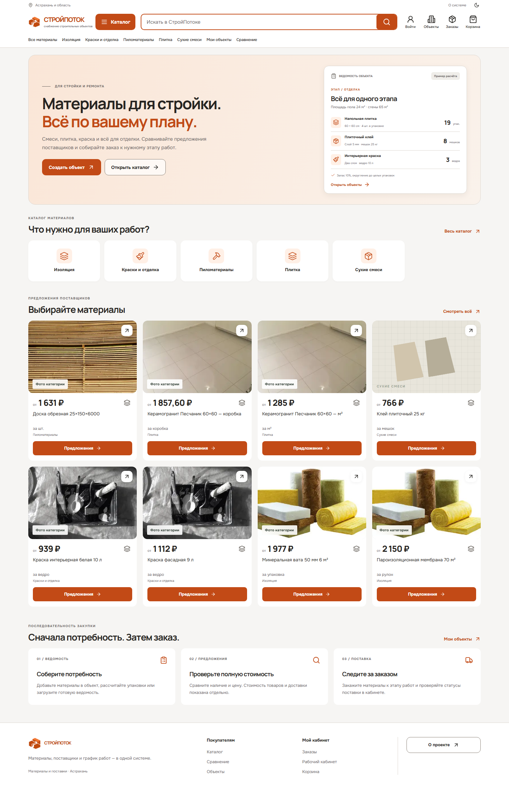

# СтройПоток

«СтройПоток» — функциональный прототип информационной системы снабжения строительного объекта. Снабженец или прораб переносит ведомость материалов, рассчитывает количество упаковок, сравнивает предложения поставщиков и оформляет закупку к выбранному этапу работ. Обычная покупка из каталога также доступна. Поставщик управляет ценой и остатками, диспетчер назначает рейс, водитель отмечает этапы доставки.



[Каталог](docs/screenshots/catalog.png) · [Закупка для объекта](docs/screenshots/project-detail.png) · [Сравнение с доставкой](docs/screenshots/comparison.jpg) · [Калькулятор материалов](docs/screenshots/material-calculator-desktop.png)

Новый сценарий закупки по этапу: [план на широком экране](docs/screenshots/procurement-stage-desktop.png) · [план на телефоне](docs/screenshots/procurement-stage-mobile.png) · [оформление на телефоне](docs/screenshots/stage-checkout-mobile.png).

Импорт ведомости объекта: [предпросмотр на широком экране](docs/screenshots/project-import-desktop.png) · [предпросмотр на телефоне](docs/screenshots/project-import-mobile-dark.png).

Карта поставки с выбором склада: [широкий экран](docs/screenshots/delivery-map-desktop.png) · [телефон, тёмная тема](docs/screenshots/delivery-map-mobile-dark.png).

Кабинет водителя с составом груза: [широкий экран](docs/screenshots/driver-workspace-desktop.jpg) · [телефон, тёмная тема](docs/screenshots/driver-workspace-mobile-dark.jpg).

Планирование поставок: [кабинет диспетчера](docs/screenshots/dispatcher-workspace-desktop.jpg) · [назначение на телефоне](docs/screenshots/dispatcher-workspace-mobile-dark.jpg).

Ассортимент поставщика: [поиск и условия предложений](docs/screenshots/supplier-workspace-desktop.jpg) · [редактор на телефоне](docs/screenshots/supplier-editor-mobile-dark.jpg).

Управление каталогом: [обзор администратора](docs/screenshots/admin-workspace-desktop.jpg) · [редактор товара на телефоне](docs/screenshots/admin-editor-mobile-dark.jpg).

Товары, организации и заказы учебного набора вымышлены. Подтверждение оплаты меняет статус заказа; деньги не списываются. Статусы рейса водитель отмечает вручную. Карта связывает сохранённые склады поставки с выбранной точкой доставки; движения автомобиля и GPS нет.

## Запуск

Нужен Docker с Compose. На свободном порту 3000 выполните:

```bash
cp .env.example .env
docker compose --project-name stroypotok up --build -d
```

На Windows скопируйте файл `.env.example` в `.env` любым удобным способом. Перед запуском задайте свой `POSTGRES_PASSWORD` в `.env`. Сайт будет доступен по адресу [localhost:3000](http://localhost:3000). Описание методов находится в [OpenAPI](api/openapi.yaml). Первый запуск применяет миграции и загружает демоданные. Даты этапов учебного объекта назначаются на 30 и 60 дней после первой загрузки; при повторном запуске уже созданный объект не меняется. Для просмотра журналов: `docker compose --project-name stroypotok logs --tail=100 api web db`. Используйте то же имя проекта при ручных командах и запуске через `Запустить.cmd`, чтобы обращаться к одной базе.

На Windows можно открыть `Запустить.cmd`: он создаст `.env` с отдельным паролем локальной базы, запустит Docker и приложение. `Остановить.cmd` остановит контейнеры, сохранив данные. Первый запуск требует интернета для загрузки образов и зависимостей.

Карта работает без платных ключей: Leaflet показывает улицы OpenStreetMap, метки складов и адрес доставки. Для адресов начального набора сохранены шесть дорожных маршрутов OSRM; они доступны и без внешнего сервиса. Остальные участки запрашиваются у OSRM с ограничением частоты и времени ожидания. Источник маршрута указан рядом с картой. При отказе подложки остаются метки и сохранённые дорожные участки; это ограниченный фрагмент, а не полная офлайн-карта города.

При оформлении выберите адрес из подсказки, чтобы сохранить точку заказа. Произвольный ручной адрес допускается без координат. Если в поставке несколько складов, можно выбрать нужный меткой или списком. Маршрут не проверяет ограничения грузового транспорта, а время в пути не является обещанием срока доставки. Дополнительно предусмотрены 2ГИС и DaData; с действующими ключами они пока не проверены. [Настройка сервисов](docs/DEPLOY.md).

## Демонстрационные учётные записи

Для всех записей пароль `Demo2026!`.

| Роль | Логин |
| --- | --- |
| Покупатель | `buyer@example.test` |
| Поставщик | `supplier@example.test` |
| Второй поставщик | `supplier2@example.test` |
| Диспетчер | `dispatcher@example.test` |
| Водитель | `driver@example.test` |
| Администратор | `admin@example.test` |

Начать удобно с покупателя: открыть каталог, добавить предложения в корзину, выбрать адрес и оформить заказ. После учебного подтверждения оплаты можно войти как диспетчер и водитель, чтобы пройти поставку до завершения.

На новой базе загружаются 48 товаров в пяти категориях, 96 предложений двух поставщиков, шесть объектов, 12 заказов и 19 поставок. Есть ожидающие назначения, назначенные, загруженные, выполняемые и завершённые поставки, а также история отменённых и истёкших заказов. У поставщика доступны примеры предложения без остатка и выключенного предложения. Для показа оплаты оформите новый заказ: начальный набор не создаёт резерв, который успеет истечь до выступления.

В «Моих объектах» есть «Ремонт жилого дома» и «Отделка двухкомнатной квартиры», а также примеры других работ. Квартира содержит рассчитанные 19 коробок плитки и 8 мешков клея к облицовке, 3 ведра краски к следующему этапу. Исходные параметры: плитка 24 м² с запасом 10%; клей для той же площади, слой 5 мм и расход 1,5 кг/(м²·мм); краска 65 м², два слоя по 0,16 л/м² и запас 10%. Это учебные нормы. Повторная загрузка не переписывает ведомости, цены, имена и остатки. Расширенный набор создаётся только на новой базе; уже заполненная база сохраняет своё содержимое.

Заказы на Савушкина, 6 и Адмиралтейская, 14 содержат адресную точку и снимки складов: их можно сразу посмотреть на карте. В примерах с ручным адресом без координат показано соответствующее ограничение. Повторная загрузка сохраняет уже созданные заказы и изменения остатков.

## Состав проекта

- `web/` — Next.js, React и TypeScript; адаптивный интерфейс калькуляторов и закупки.
- `api/` — NestJS API, OpenAPI, миграции и загрузка демоданных.
- `docs/` — руководство, архитектура, расчёты и результаты проверки.

Фотографии категорий взяты из Wikimedia Commons; авторы и условия использования перечислены в [списке изображений](docs/IMAGE_CREDITS.md). Фото в карточке показывает тип материала, а не конкретную позицию на складе.

Хранение данных — PostgreSQL. Денежные суммы передаются в копейках и фиксируются в заказе. При оформлении остатки проверяются и резервируются внутри транзакции; повтор запроса с тем же ключом не создаёт второй заказ.

## Документация

- [Руководство пользователя](docs/USER_GUIDE.md)
- [Расчёт материалов, фасовка и округление](docs/MATERIAL_CALCULATIONS.md)
- [Архитектура](docs/ARCHITECTURE.md), [модель данных](docs/DATA_MODEL.md) и [контракт API](docs/API_CONTRACT.md)
- [Запуск и развёртывание](docs/DEPLOY.md)
- [Результаты проверки](docs/TEST_RESULTS.md)
- [Запуск браузерных испытаний](docs/BROWSER_TESTS.md)

Исходный код распространяется по лицензии [MIT](LICENSE).
